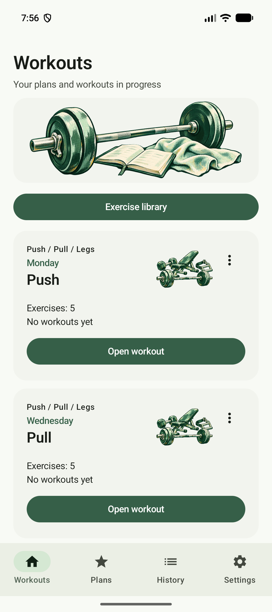
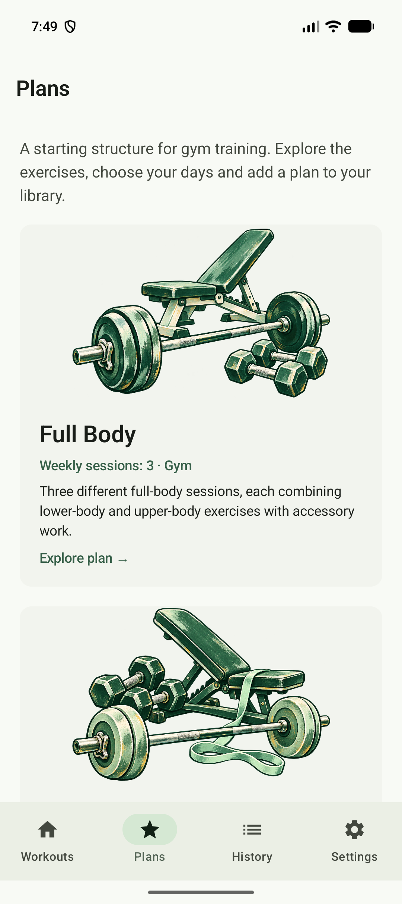
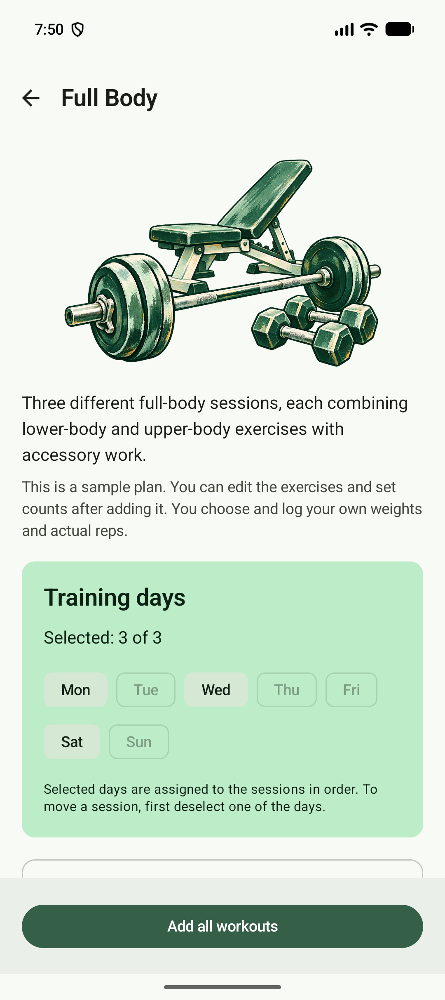
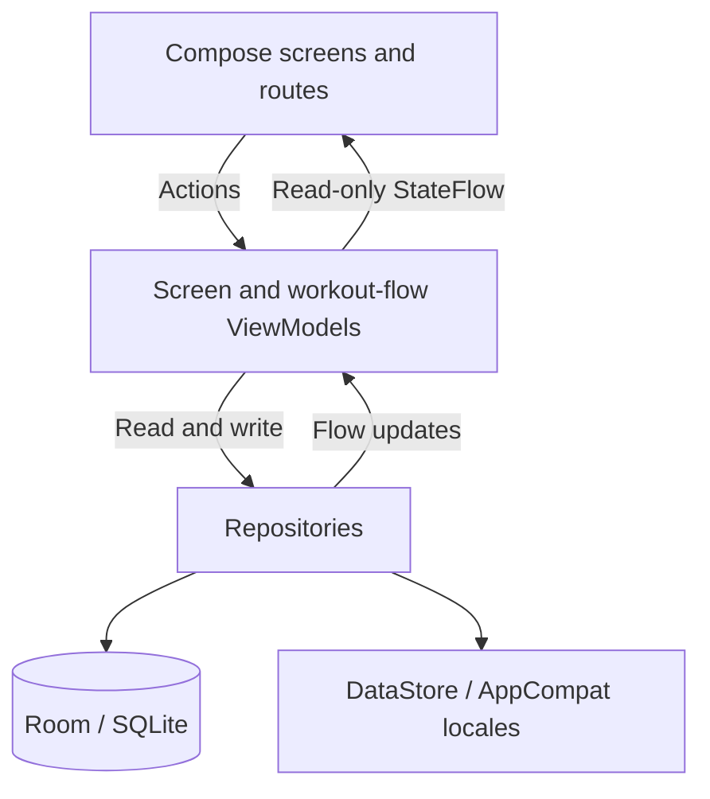

<div align="center">
  
  <h1>RepNote</h1>
  <p>A local strength training journal for Android.<br>Plan your workouts, log your sets, and keep your previous results close.</p>
  <p>
    
    
    
    
    
  </p>
</div>

## Demo

**Watch the demo: [▶ Watch the demo on YouTube](https://youtu.be/Qgr9cTWl16s)**

## Overview

RepNote is a personal Android project for people who want a straightforward record of their strength training. Start with a built-in gym plan or create a workout, record weights and repetitions, and review earlier sessions when choosing your next working weight.

The app works locally without an account or backend. Its four main tabs are **Workouts**, **Plans**, **History**, and **Settings**. A forest-green palette, notebook-inspired branding, and illustrated training equipment give the interface a consistent visual identity.

## Key Features

- **Ready-to-use gym plans:** explore Full Body, Upper / Lower, and Push / Pull / Legs; select training weekdays and add all sessions of a plan to your library.
- **Custom workout templates:** create, rename, edit, and delete workouts; reorder exercises and choose 1–10 initial sets per exercise. Templates with an active draft must have that draft discarded before editing or deletion.
- **Personal exercise library:** add and edit exercise names and notes. Exercises referenced by a workout template are protected from deletion.
- **Set-by-set logging:** enter weight in kilograms and repetitions, add or remove sets, mark valid sets complete, and move to the next exercise. The latest saved result for the same exercise appears in the current entry screen.
- **Resumable sessions:** workout drafts are saved locally. Finish a workout to record its completed sets, or discard the draft with confirmation.
- **Rest timer:** choose 60, 90, or 120 seconds; start, pause, or reset the countdown. Completing a valid set restarts the timer automatically, and its saved deadline allows restoration after reopening the app within the same device boot.
- **Searchable history:** filter by workout name or the last 7 / 30 days, view workout and active-day counts, open session details, and delete a session with confirmation.
- **Appearance and language:** system, light, and dark themes; English, Russian, Ukrainian, and Polish interfaces with system-language selection, localized dates and numbers, and a confirmed reset of local records and settings.

## Screenshots

<table>
  <tr>
    <th>Workout library</th>
    <th>Built-in plans</th>
    <th>Training weekdays</th>
  </tr>
  <tr>
    <td></td>
    <td></td>
    <td></td>
  </tr>
</table>

## Tech Stack

| Technology | Purpose in this project |
| --- | --- |
| Kotlin | Application models, validation, ViewModels, repositories, and Compose UI. AGP provides built-in Kotlin support. |
| Jetpack Compose + Material 3 | Screen layouts, forms, dialogs, bottom navigation, reusable set-entry controls, and themed surfaces. Compose animations handle navigation and list changes. |
| AndroidX ViewModel + StateFlow | Own screen and workout-flow state; expose read-only observable state to Compose through `collectAsStateWithLifecycle()`. |
| Kotlin Coroutines + Flow | Run asynchronous storage operations and combine template, session, preference, and filter updates. A mutex serializes draft persistence and workout completion. |
| Navigation 3 | Serializable destination keys, a saved back stack, `NavDisplay`, and per-entry state / ViewModel store decorators. |
| Room 3 + AndroidSQLiteDriver | Store exercises, ordered workout templates, completed sessions, set results, and JSON workout drafts in a local SQLite database. Schema version 6 declares automatic migrations from versions 1 through 6. |
| Preferences DataStore | Persist theme selection and the rest timer snapshot. Language persistence uses Android's app-locale mechanism instead. |
| Kotlin Serialization | Encode and restore workout drafts and timer snapshots as JSON; serialize navigation keys. |
| AppCompat | Host the Compose UI in a single `AppCompatActivity` and apply app-language changes through `AppCompatDelegate`, including on older Android versions. |
| Manual dependency injection | `RepNoteApplication` creates the database and repositories; ViewModel factories pass repository dependencies through constructors. |
| Gradle Kotlin DSL, version catalog, KSP | Configure the single app module, pin dependencies, and generate Room database code. |
| Networking | No application network layer or `INTERNET` permission is present. Built-in plans and artwork ship with the app. |

These entries reflect production code usage. Preview fixtures and declared test dependencies are not application features or evidence of test coverage.

## Architecture

The app implements **MVVM with unidirectional state flow** in a single `:app` module, organized into UI, model, and data packages.

Route composables collect ViewModel state and wire callbacks to screen composables. The navigation host also performs this wiring directly for the workout library, workout details, and settings. Screen content receives state and callbacks, which keeps it usable in Compose previews without a database.

User actions reach ViewModels, which validate input and call repositories. Repositories map Room records into application models or expose preference flows. Observable updates then return to the UI. Dedicated ViewModels cover the builder, plan browser, exercise catalog, history, and session result; draft and timer ViewModels are shared across the workout flow. Settings state is also observed at the activity level to apply the theme.



`WorkoutTemplate` represents a reusable routine; `WorkoutDraftUiState` holds in-progress set input; `WorkoutSession` captures completed exercise names and results at the time of saving. Session snapshots remain independent of later template edits or deletion. Drafts are persisted in Room with a `SavedStateHandle` fallback, while history filters and plan-day selection also use saved state.

## Project Structure

```text
app/
  src/main/
    java/com/example/repnote/
      data/local/       # Room database, DAOs, entities, and mapping
      data/plans/       # Built-in plan definitions and import mapping
      data/repository/  # Templates, sessions, drafts, and settings access
      model/            # Workout, exercise, session, and preference models
      ui/components/    # Reusable controls, artwork, and storage feedback
      ui/navigation/    # Destination keys, back stack, and tab layout
      ui/screens/       # Routes, screens, and screen previews
      ui/state/         # UI states and set/session transformations
      ui/viewmodel/     # Screen and workout-flow state owners
      ui/theme/         # Colors, typography, and shapes
      ui/util/          # Locale-aware date, number, and weekday formatting
    res/                # Localized strings, artwork, icons, and XML resources
  schemas/              # Exported Room schemas, versions 1–6
  src/test/             # Existing local test sources
  src/androidTest/      # Existing instrumented test sources
gradle/                 # Wrapper, daemon JVM criteria, and version catalog
assets/                 # Branding and illustration sources with asset notes
docs/                   # Stack notes, implementation reports, and screenshots
RepNote-Learning/       # Learning notes, project brief, and design references
```

## Getting Started

### Requirements

| Item | Configuration checked into this project |
| --- | --- |
| Android device or emulator | API 24 or above (`minSdk = 24`) |
| Android SDK | Compile SDK 37; target SDK 37 |
| Gradle | Use the included Wrapper, version 9.6.0 |
| Android Gradle Plugin | 9.4.1 |
| Gradle daemon JVM | Java 25 in `gradle/gradle-daemon-jvm.properties` |
| Java source / bytecode target | Java 11 in `app/build.gradle.kts`; this is separate from the Gradle runtime JVM |
| Android Studio | A version compatible with the pinned AGP and Gradle; an exact IDE version is not recorded |

**JVM configuration note:** the earlier [stack notes](docs/android-stack.md) record a build using JDK 21, while the checked-in daemon criteria request Java 25. Follow the daemon criteria for an unmodified checkout and ensure that JVM is available. This discrepancy has not been resolved through a fresh build during this documentation update.

### Open and run

1. Download or clone this project and open its root folder in Android Studio.
2. Make Android SDK Platform 37 available. Configure the SDK through Android Studio or an untracked `local.properties` containing your own `sdk.dir` value.
3. Make the requested Gradle daemon JVM available and sync the project. Gradle resolves dependencies from Google Maven, Maven Central, and the Gradle Plugin Portal; initial setup needs network access.
4. Select the `app` run configuration and an existing compatible Android device or emulator, then run the debug variant. No API keys, service accounts, or backend setup are required.

To compile and run Android Lint from the project root:

```bash
./gradlew :app:assembleDebug :app:lintDebug
```

On Windows, use `gradlew.bat`. The debug APK is written to `app/build/outputs/apk/debug/app-debug.apk`.

For a separate manual-review installation, the existing optional property adds an application ID suffix:

```bash
./gradlew :app:assembleDebug -Prepnote.verificationSuffix=.review
```

On a fresh install, add a built-in plan from **Plans**, or create exercises and a workout from **Workouts**. Log at least one completed set before finishing a session; only completed valid sets enter history.

Build, lint, and automated test tasks were not run for this documentation-only update. Existing test sources are preserved; the current working agreement does not add, modify, or run automated tests. Earlier verification is documented in the reports below.

## Technical Highlights

1. **Atomic workout completion.** A Room transaction inserts the session, ordered exercise snapshots, and sets while updating the remaining drafts. A persistence mutex coordinates this operation with pending draft saves.
2. **History that survives template changes.** Session records store workout titles and exercise names separately from live templates. Deleting a template does not cascade into saved sessions; deleting a session cascades through its own exercise and set records.
3. **Transactional plan import.** A plan's workouts, weekday assignments, and exercise links are imported together. Stable exercise keys reuse shared exercises across plans, and duplicate plan import is blocked while any workout from that plan remains installed.
4. **Restoration based on elapsed time.** The timer stores a monotonic deadline and device boot count rather than persisting every tick. Reopening during the same boot recalculates the remaining time; a reboot invalidates the deadline and restores the selected duration.
5. **Localization through platform APIs.** AppCompat applies app locales across screens and dialogs. All four language resource sets are bundled without language splitting; date and weight formatting use the selected locale, and some secondary artwork is hidden at larger font scales.

## Limitations

- There is no app-managed cloud synchronization or export/import flow. Android system backup is enabled in the manifest; local storage does not imply exclusion from operating-system backup.
- Plan weekdays describe a repeating weekly arrangement. There are no dated calendar events, scheduled reminders, or timer-completion notifications.
- Weight entry uses kilograms only. Built-in plans are editable examples; the app does not calculate personalized training prescriptions.
- Imported plan names and notes become stored library text. Switching the interface language does not translate those existing records.
- The existing verification reports cover an API 37 emulator. Physical devices, older Android versions, and tablets are not established as verified by those reports.

## Further Documentation

- [Workout plans, artwork, and prior verification](docs/workout-plans-report.md)
- [Earlier implementation report](docs/implementation-report.md)
- [Pinned Android stack and compatibility notes](docs/android-stack.md)
- [Branding assets](assets/branding/README.md) · [Illustration assets](assets/illustrations/v2/README.md)

Implementation reports and asset notes are currently written in Russian.
